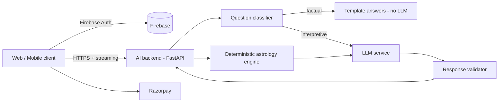

# SarvDrishti AI: Showcase

**A bilingual (English/Hindi) Vedic astrology platform with an AI astrologer.** Live at [sarvdrishti.com](https://sarvdrishti.com).

> This repository is a **documentation-only showcase**. The production source code is private (company project), so no code, keys or user data are published here.

## What it does

| Area | Details |
|---|---|
| AI astrologer | Conversational answers about a user's birth chart in English or Hindi, streamed to the client |
| Kundli | Birth charts rendered as dynamic SVG, with Hindi planet labels |
| Matchmaking, Panchang, Din Chakra | Compatibility scoring, daily panchang, and a 24-hour day-quality view |
| Rashifal | Daily, weekly and monthly readings for all 12 signs |
| Wallet and payments | Credit top-ups with Razorpay; a prompt to add credits when the AI chat has none |
| Astrologer side | Apply, go online, accept requests, weekly hours, earnings |
| Accounts | Google sign-in and onboarding, shared with the mobile app |

## My role

I built and shipped the **web application** and contributed to the **AI backend**:

- **Web app:** Next.js 16, React 19, TypeScript and Tailwind CSS 4; Firebase auth and data shared with the mobile app; Razorpay payments; responsive, bilingual UI.
- **Charts:** kundli charts as dynamic SVG with responsive image fitting.
- **AI backend contributions:** tuned the LLM prompts (response-length budgets and token caps, an i18n register rule for Hindi and English, age-aware marriage-prediction logic, horizon caps), and wrote the system architecture and web-integration docs.

## Architecture

Key design ideas in the backend:

1. **Deterministic first, LLM last.** Planets, houses, dashas and compatibility are computed in Python; the model only interprets pre-computed facts, which limits hallucination and cost.
2. **LLM output is untrusted.** Responses are validated against the real chart before the user sees them.
3. **Cheapest sufficient path.** A tiered classifier sends factual questions to zero-LLM answers, and caches interpretive ones.
4. **Observable.** Model calls are traced with quality scores and user feedback.

## Tech stack

Next.js 16 · React 19 · TypeScript · Tailwind CSS 4 · Firebase (Auth, Realtime Database, Cloud Functions) · Razorpay · VideoSDK · FastAPI (Python) · Docker · pnpm and Turborepo · GitHub Actions CI/CD

## Contact

Aditya Sharma: [LinkedIn](https://linkedin.com/in/addityaasharma) · addityaasharma@gmail.com
